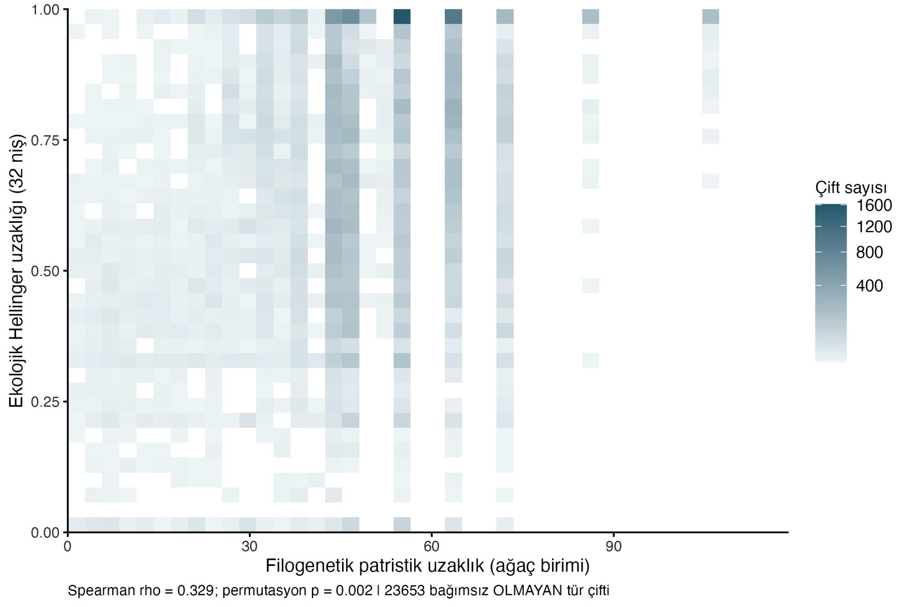
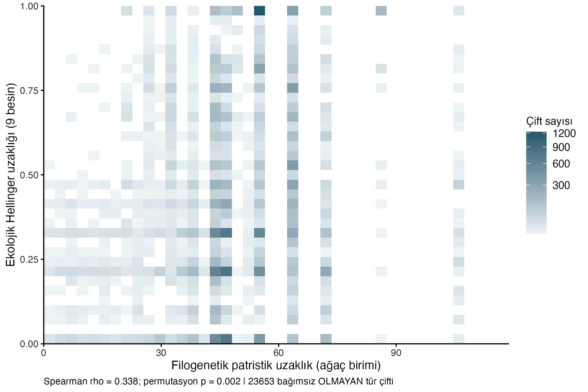
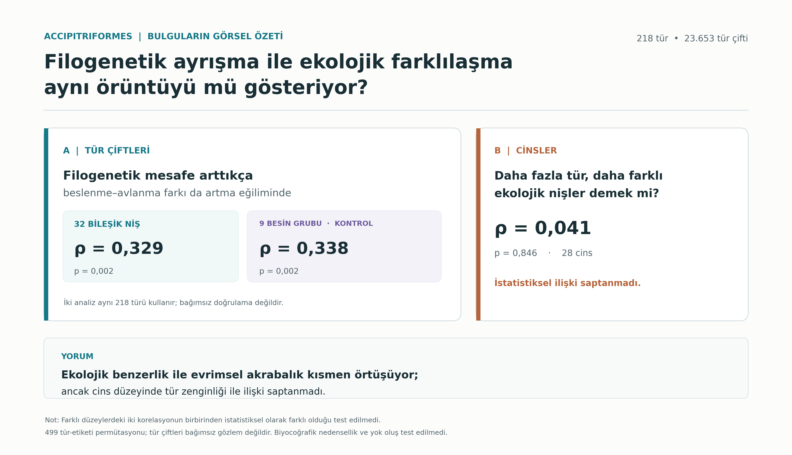

{
  "title": "R ile ekolojik niş ve filogenetik uzaklık analizi: Beyond Species Richness",
  "seo_title": "Beyond Species Richness | R ile filogenetik ve ekolojik niş analizi | ERES",
  "description": "251 yırtıcı kuş, 218 filogenetik eşleşme, Hellinger uzaklığı, Spearman korelasyonu ve tür-etiketi permütasyonu: NaturaLogic ile açık yöntemli bilimsel araştırma.",
  "date": "2026-11-25T00:00:00+03:00",
  "draft": false,
  "article_id": "NR-2026-01",
  "category_label": "Açık Bilim · Ekoloji ve Evrimsel Biyoinformatik",
  "answer_first": "251 yırtıcı kuşun ekolojik profillerini ve 218 türün filogenetik ilişkilerini R ile karşılaştırdık. Bu bilimsel vaka çalışması veri entegrasyonunu, uzaklık matrislerini, istatistiksel çıkarımı ve sonuçların sınırlarını özgün R betikleriyle birlikte ele alıyor.",
  "product_path": "/post/biyoinformatik-icin-r-programlama/",
  "product_cta": "R programlama çalışma programını inceleyin",
  "capability_bridge": "Bu araştırmadaki veri hazırlama, matris işlemleri, istatistik ve görselleştirme adımlarını kendi yaşam bilimleri araştırmalarınıza taşımak için R programlama çalışma programını inceleyebilirsiniz.",
  "tags": [
    "R",
    "Filogenetik",
    "Ekoloji",
    "Biyoçeşitlilik",
    "Açık Bilim"
  ],
  "author": "Elçin Ekşi"
}

*An exploratory, multidimensional assessment of trophic niche differentiation and phylogenetic distance in Accipitriformes.*

**ERES Biyoinformatik Akademi | NaturaLogic ile bilimsel iş birliği · NR–2026–01**
**Yazar:** Elçin Ekşi
**Tarih:** 25 Kasım 2026 · v1.0 (pilot analiz: 19 Kasım 2026)
**Yayın türü:** Keşifsel bilimsel araştırma / açık yöntemli vaka çalışması.
**Veri ve kod:** AVONET (Tobias ve ark., 2022); AVONICHE (Sayol ve ark., 2026); Aves 1.3 filogenetik sentezi (McTavish ve ark., 2025); NaturaLogic açık analiz betikleri.

> **Temel sonuç:** İncelediğimiz yırtıcı kuşlarda evrimsel olarak daha uzak tür çiftleri, beslenme–avlanma nişleri bakımından da daha farklı olma eğilimindedir. Buna karşılık cinslerde daha fazla tür bulunması, ortalama cins içi niş farklılaşmasıyla bu örneklemde anlamlı bir monoton ilişki göstermemiştir. Bu örnek, tür sayısını, ekolojik farklılaşmayı ve evrimsel geçmişi tek bir gösterge gibi görmemenin önemini anlatır. **Ancak sonuçlarımız ekosistemlerin işleyişini veya herhangi bir işletmenin biyoçeşitlilik performansını doğrudan ölçmez.**

> **Bir araştırma, iki farklı uygulama alanı.** NaturaLogic ile bilimsel iş birliği kapsamında yürütülen bu araştırmanın ekolojik ve filogenetik analizlerini ERES Akademi'de ele alıyoruz. Aynı bilimsel bulguların biyoçeşitlilik göstergeleri, kurumsal doğa zekâsı ve iş kararları açısından nasıl yorumlanabileceğini ise NaturaLogic'te inceleyebilirsiniz.
>
> [NaturaLogic — Doğa verilerinden iş zekâsına →](https://naturalogiclabs.com/research/beyond-species-richness/)

## Özet

Biyoçeşitlilik, en sık tür sayısı üzerinden tanımlanır. Tür zenginliği gerekli bir başlangıç ölçüsüdür; ancak farklı türlerin kullandıkları kaynakların, beslenme–avlanma stratejilerinin ve evrimsel geçmişlerinin ne ölçüde çeşitlendiğini tek başına göstermez. NaturaLogic'in bu kurum içi bilimsel vaka çalışması, Accipitriformes olarak sınıflandırılmış kuş türlerine ilişkin açık küresel veri setlerini kullanarak birden fazla ekolojik çeşitlilik boyutunun birlikte incelenmesini örneklendirmektedir. AVONET ve AVONICHE veri setleri BirdTree taksonomi sürümüyle eşleştirilmiş, 251 tür için dokuz besin ve 32 bileşik beslenme–avlanma nişi profili değerlendirilmiştir. Bu türlerin 218'i yayımlanmış Aves 1.3 filogenetik sentez ağacının Clements 2022 sürümüyle ad düzeyinde eşleştirilmiş, 23.653 benzersiz tür çiftinde filogenetik patristik uzaklık ve Hellinger ekolojik uzaklığı hesaplanmıştır. Uzaklık sıraları arasında Spearman korelasyonu ve 499 tür-etiketi permütasyonu uygulanmıştır. Ana analiz 32 niş için pozitif ilişki vermiştir (ρ=0,329; iki yönlü etiket-permütasyonu p=0,002). Dokuz üst besin kategorisinde benzer sonuç bulunmuştur (ρ=0,338; p=0,002). En az iki eşleşmiş tür içeren 28 cinste tür zenginliği ve ortalama cins içi niş uzaklığı arasındaki keşifsel ilişkinin katsayısı ise ρ=0,041 (p=0,846) olarak hesaplanmıştır. Bulgular, taksonomik zenginlik, filogenetik uzaklık ve beslenme–avlanma farklılaşmasının birbirinin yerine kullanılamayan kavramlar olduğunu öğretmek için veri temelli bir örnek sunmaktadır. İstatistiksel yöntem keşifsel niteliktedir; tarihsel nedenler, mekânsal topluluk işlevleri ve kurumsal etki sınanmamıştır.

**Anahtar kelimeler:** Biyoçeşitlilik göstergeleri; tür zenginliği; Accipitriformes; beslenme–avlanma nişi; filogenetik uzaklık; Hellinger; açık bilim; NaturaLogic.

## 1. Neden bu soruyu soruyoruz?

Bir alanda kaç canlı türü olduğunu bilmek değerlidir. Fakat aynı sayıdaki türler aynı besinleri tüketiyor, aynı kaynaklardan yararlanıyor veya aynı ekolojik rolleri üstleniyor olmak zorunda değildir. Ayrıca taksonomik yakınlık ile ekolojik benzerlik özdeş değildir. Bu ayrım, biyolojik çeşitliliğin taksonomik, filogenetik ve işlevsel boyutları üzerine geliştirilen araştırma ve izleme yaklaşımlarının temelidir [1, 2].

NaturaLogic'in bilimsel sorusu şudur: **Yalnızca türleri saydığımızda veya bütün karmaşıklığı tek bir korelasyon katsayısına indirdiğimizde ekolojik farklılaşmanın hangi yönlerini gözden kaçırıyoruz?** Bu soruya doğrudan bir ekosistem ölçümü yaparak değil, küresel ölçekte yayımlanmış kuş özelliklerini örnek bir veri sistemi olarak kullanarak yaklaşmayı seçtik. Böylece yaygın kullanılan ölçülerin hem bilgilendirici yanlarını hem de sınırlarını aynı çalışma içinde gösterebiliyoruz.

Bu çalışma iki farklı ölçeği bilerek ayırır: (i) yaşayan türler arasında **filogenetik ve beslenme–avlanma nişi uzaklıklarının** eşleşmesi, (ii) **cins düzeyinde** tür zenginliği ile cins içi ekolojik farklılaşma ilişkisi. Bunlar aynı hipotez değildir. İkinci karşılaştırma birinci bulgunun bağımsız kanıtı veya karşıtı olarak okunmamalıdır.

### Neden yırtıcı kuşlar?

Accipitriformes üyelerinin önemli bir bölümü besin ağlarında üst trofik düzeylerde bulunur; avcılar ve leşle beslenen türler farklı kaynakları kullanır. Bu kuşların popülasyonları av veya leş kaynaklarına, uygun habitatlara ve üreme koşullarına bağlıdır. Bu nedenle bazı türler, belirli çevresel baskılar ve ilişkili biyoçeşitlilik bileşenleri için değerli gösterge adaylarıdır. Üst yırtıcıları inceleyen bir derleme [9] ve 2022 tarihli meta-analiz [10], bu potansiyelin ekolojik bağlama bağlı olduğunu; özellikle yırtıcının kaynaklarıyla daha yakından ilişkili canlı gruplarında gösterge performansının daha yüksek olabildiğini ortaya koymaktadır.

Trofik nişleri ayırt etmek bu nedenle koruma biyolojisi açısından önemlidir: aynı sayıda türün bulunduğu iki sistemin besin ağı yapısı ve kaynak ilişkileri farklı olabilir. Ancak burada tüm Accipitriformes üyelerinin aynı trofik seviyede ya da her ekosistemde tepe yırtıcısı olduğu varsayılmadı. Çalışmamız yerel topluluk, bolluk, üreme başarısı, av mevcudiyeti veya ekosistem sağlığı verisi içermediğinden bu bağlantı literatüre dayalı araştırma gerekçesidir; kendi analizimizin doğrudan sınadığı bir hipotez değildir.

## 2. Araştırma soruları ve yorum sınırı

**Soru 1.** Filogenetik olarak uzak tür çiftleri, 32 bileşik beslenme–avlanma nişi bakımından daha mı farklıdır? **Ana analiz.**

**Soru 2.** Aynı eğilim dokuz daha geniş besin grubunda da görülüyor mu? **Bağımsız doğrulama değil, çözünürlük duyarlılığı.**

**Soru 3.** İncelenen cinsler içinde daha fazla eşleşmiş tür bulunması, ortalama cins içi ekolojik uzaklığın daha yüksek olmasıyla ilişkili mi? **Keşifsel analiz.**

Bu sorular yalnızca **yaşayan türler arasındaki beslenme–avlanma profillerinin farklılaşmasını** araştırır. Ekolojik nişlerin geçmişte boş olduğunu, türleşmenin coğrafi izolasyonla gerçekleştiğini, eşeysel seçilimin rolünü, yok oluş zamanlarını veya belirli bir alandaki ekosistem sağlığını göstermez.

## 3. Veri kaynakları

### 3.1 AVONET: eşleştirme ve taksonomi çerçevesi

AVONET, kuşların morfolojik, ekolojik ve coğrafi özelliklerine ilişkin küresel, açık veri kaynağıdır [3]. Bu çalışmanın ilk veri hazırlama aşamasında **BirdTree taksonomisiyle uyumlu tür adlarını bir araya getirmek** için kullanıldı. AVONET'in morfolojik ölçümleri bu pilotun ana istatistiksel testinde kullanılmadı; dolayısıyla sonuçları morfolojik özelliklerin evrimi olarak sunmuyoruz.

### 3.2 AVONICHE: ekolojik profil

AVONICHE, dokuz ana besin grubunu, avlanma davranışları ve kaynak elde etme biçimleriyle birlikte 32 bileşik nişe ayırır [4]. Her tür için bu kategorilere ayrılmış oransal skorlar kullanıldı. Bu skorlar, her bir türde bağımsız olarak yüzlerce avlanma olayı saydığımız saha verileri değildir; yayımlanmış bilgilerden türetilmiş ve bazı türlerde yakın akraba bilgileriyle tamamlanmış yarı nicel profillerdir. Bu nedenle türler arası **beslenme–avlanma farklılaşmasını temsil eden bir vekil değişken** olarak değerlendirildi.

### 3.3 Filogenetik ağaç

McTavish ve arkadaşlarının Aves 1.3 küresel kuş filogenetik sentezinin **Clements 2022 tarihli özet ağacı** kullanıldı [5]. Bu ağaç farklı bilimsel çalışmalardan derlenen ve taksonomik bilgiyle birleştirilen bir sentezdir; analizin her türü için sıfırdan DNA dizisi çözülmemiştir. Doğrudan ad eşleştirmesiyle 251 türün 218'i ağaca yerleştirildi. **Eşleşmeyen 33 türün** eksikliği, sonuçların kapsayıcılığını sınırlar.

## 4. Yöntem: hangi sayı nasıl ortaya çıktı?

### 4.1 Çalışma birimleri

Başlangıçta 251 türün profili doğrulandı. Filogenetik karşılaştırmada 218 tür eşleşti. Her türün diğerleriyle birer kez karşılaştırılmasıyla **218×217/2 = 23.653 benzersiz tür çifti** elde edildi. Bu değer 23.653 bağımsız kuş gözlemi demek değildir: aynı tür birçok farklı çiftin içinde tekrar bulunur.

### 4.2 Hellinger uzaklığı: ekolojik profilin farklılığı

32 niş skorunun toplamı her tür için yaklaşık %100'dür. Önce yüzdeler toplamına bölünerek oranlara dönüştürüldü, sonra karekök dönüşümü uygulandı. İki türün ekolojik uzaklığı:

<p><strong>H(i,j) = √[½ × Σ<sub>k=1…32</sub> (√p<sub>ik</sub> − √p<sub>jk</sub>)<sup>2</sup>]</strong></p>

Burada p<sub>ik</sub>, *i* türünün *k* nişine ayırdığı orandır. Değer **0** ise profiller aynıdır; **1** ise aynı kategorilere hiç pay ayrılmamıştır. Karekök dönüşümü çok yüksek oranlı kategorilerin karşılaştırmayı tek başına baskılamasını yumuşatır; iki profilde de sıfır olan kategoriler uzaklığa katkı yapmaz. Bu yaklaşım oransal ve çok sayıda sıfır içeren ekolojik veriler için anlaşılabilir bir ölçü sağlar [6]. Hellinger mesafesi, **niçin** farklılaşıldığını değil, **ne kadar** farklılaşıldığını hesaplar.

### 4.3 Filogenetik uzaklık

Her tür çifti için ağacın iki ucunu birleştiren dalların uzunlukları toplanarak **patristik uzaklık** elde edildi. Uzaklıklar ağacın kaynak dosyasındaki dal uzunluğu birimine bağlıdır. Bu değerleri doğrudan yeni bir tarihlendirme analizi veya evrim hızına ilişkin tahmin olarak yorumlamıyoruz.

### 4.4 Spearman sıra korelasyonu ve rastgele atama

Filogenetik ve ekolojik uzaklık matrislerinin üst üçgenindeki aynı tür çiftleri eşleştirildi. **Spearman ρ**, iki mesafenin sıralarının birlikte artıp artmadığını özetler. Dağılımların doğrusal biçimde ilişkili olması gerektiği varsayılmadı. Ardından filogenetik mesafe matrisi sabit tutulup **ekolojik uzaklık matrisinin tür etiketleri** birlikte yeniden sıralandı. Bu işlem 499 kez yapıldı (`set.seed(20261119)`); her denemede Spearman katsayısı yeniden hesaplandı.

İki yönlü permütasyon olasılığı:

<p><strong>p = (1 + N<sub>uç</sub>) / (499 + 1)</strong></p>

Burada N<sub>uç</sub>, |ρ<sub>perm</sub>| ≥ |ρ<sub>obs</sub>| koşulunu sağlayan permütasyonların sayısıdır.

Gözlenen değere en az onun kadar uç bir rastgele sonuç çıkmadığında en küçük olası p **1/500 = 0,002** olur. Bu, “hipotez %99,8 olasılıkla doğrudur” anlamına gelmez. Ayrıca tür etiketlerinin rastgele dağıtılması, **filogenetik karakter evrimini bütünüyle modellemez**. Bu Mantel-tipi yaklaşımın gücü ve hata davranışı evrimsel karşılaştırma literatüründe tartışmalıdır [7]. Sonuçlar bu nedenle **keşifsel** biçimde raporlandı.

### 4.5 Ayrı ölçek kontrolü ve cins karşılaştırması

32 bileşik niş analizi ana testtir. Dokuz üst besin grubu aynı temel ekolojik profilden türediği için **bağımsız tekrar değildir**; yalnızca kategori çözünürlüğünün sonucu ne kadar etkilediğini gösterir. Cins karşılaştırmasında, en az iki eşleşmiş tür içeren 28 cinste tür sayısı ile tür çiftlerinin **ortalama cins içi Hellinger uzaklığı** ilişkilendirildi. Cinsler eşit yaşta veya aynı filogenetik derinlikte evrimsel birimler değildir; bu analiz biyolojik mekanizma testi değildir. Cins analizinde 499 permütasyonda grup büyüklükleri ve üyelik indeksleri sabit tutulurken bütün ekolojik profiller tür etiketleri arasında yeniden dağıtıldı; filogenetik yapı bu sıfır modelinde korunmadı. 32 ve 9 kategori için aynı permütasyonlar kullanıldı. Cins analizinin sonucu, ekolojik uzaklıkların dağılımına ve bu keşifsel sıfır modeline bağlıdır.

### 4.6 RStudio'da yöntem nasıl uygulanıyor?

Aşağıdaki satırlar özgün `09_iki_agac_ekolojik_farklilasma_30dk.R` betiğinden alınmıştır. Bunlar tek başına çalıştırılacak ayrı bir analiz değil, mevcut iş akışının ilgili bölümleridir. Tam betikte veri kontrolü, ağaç uçları ile eşleştirme ve tür sıralamasının denetimi de yer alır.

**Ekolojik uzaklık:** `a`, tür × niş skor matrisidir. Satır toplamına bölme, karekök dönüşümü ve normalize Öklid uzaklığı sırasıyla uygulanır.

```r
a <- sqrt(a/rowSums(a))
out <- as.matrix(stats::dist(a))/sqrt(2)
```

**Filogenetik uzaklık:** ağacın iki ucu arasındaki patristik mesafe hesaplanır ve tür sırası korunur.

```r
PDist <- ape::cophenetic.phylo(phy)
PDist <- PDist[phy$tip.label, phy$tip.label, drop=FALSE]
```

**Sıra korelasyonu ve permütasyon:** `u` üst üçgeni, `phyrank` filogenetik uzaklıkların sıralarını, `R32` ve `R9` ekolojik uzaklıkların simetrik sıra matrislerini temsil eder. `N` tür sayısıdır; `B` bu çalışmada 499'dur. Bir permütasyonda satır ve sütunlara aynı tür sıralaması uygulanır.

```r
obs32 <- stats::cor(phyrank,R32[u])
obs9 <- stats::cor(phyrank,R9[u])
set.seed(20261119)
null32 <- numeric(B); null9 <- numeric(B)
for (b in seq_len(B)) {
  p <- sample.int(N)
  null32[b] <- stats::cor(phyrank,R32[p,p][u])
  null9[b] <- stats::cor(phyrank,R9[p,p][u])
}
perm_p <- function(obs,v) (1+sum(abs(v)>=abs(obs)))/(1+length(v))
```

Bu kodda `cor()` önceden sıralanmış uzaklıklar üzerinde çalıştığı için Spearman korelasyonunu hesaplar. Tür çiftlerinin tek tek rastgele karıştırılması yerine tür etiketlerinin birlikte yeniden sıralanması, uzaklık matrisinin yapısını korur. Tam iş akışı ve veri kaynakları aşağıdaki açık kod arşivinde bulunmaktadır.

## 5. Bulgular

| Karşılaştırma | Kapsam | Katsayı | İki yönlü etiket-permütasyonu |
|---|---:|---:|---:|
| Filogenetik uzaklık – 32 nişte ekolojik uzaklık | 218 tür / 23.653 çift | **ρ = 0,329** | **p = 0,002** |
| Filogenetik uzaklık – 9 besin grubunda ekolojik uzaklık | 218 tür / 23.653 çift | **ρ = 0,338** | **p = 0,002** |
| Cins tür zenginliği – ortalama cins içi niş uzaklığı | 28 cins | **ρ = 0,041** | **p = 0,846** |

**Bulguların yalın karşılığı:** Filogenetik uzaklığı daha yüksek tür çiftlerinin ekolojik profilleri de genellikle daha farklıydı; ancak ilişki kusursuz değildi. Cins ölçeğinde tür sayısı ile ortalama cins içi ekolojik farklılaşma arasında bu veri ve analizle bir ilişki saptanmadı. İkinci sonucun istatistiksel olarak anlamlı bulunmaması, her cinste niş korunumu gerçekleştiğinin veya türleşmenin ekolojik olmayan nedenlerle oluştuğunun kanıtı değildir.



**Şekil 1A.** 218 eşleşmiş türün 23.653 benzersiz tür çiftinde filogenetik patristik uzaklık ile 32 beslenme–avlanma nişinden hesaplanan Hellinger uzaklığının iki boyutlu dağılımı. Renk, ilgili bölgedeki çift sayısını gösterir; çiftler bağımsız gözlem değildir. ρ = 0,329; p = 0,002 (499 permütasyon). Dal uzunluğu birimi kaynak ağaca aittir.



**Şekil 1B.** Aynı türler ve aynı profillerden türetilen dokuz geniş besin kategorisi için duyarlılık gösterimi. ρ = 0,338; p = 0,002. Bağımsız doğrulama değildir.



**Şekil 2.** Raporlanan üç katsayının ve permütasyon p değerlerinin görsel özeti. Cins analizi 28 cinsi kapsamaktadır. Grafik yeni bir veri analizi değildir. İki farklı ölçekteki korelasyonların birbirinden anlamlı ölçüde farklı olup olmadığı sınanmamıştır. Görseller önceki çalışma arşivinden alınmıştır; ham veriden bu yayın hazırlığında yeniden hesaplanmamıştır.

## 6. Tartışma: bir sayıdan ne öğrenebiliriz, ne öğrenemeyiz?

### 6.1 Tür sayısı önemli, fakat başka boyutların yerine geçmez

Bir cinsin daha fazla türe sahip olması, bu türlerin ekolojik rolleri bakımından daha fazla farklılaşmış olması anlamına gelmez. Çalışmadaki 28 cinslik keşifsel karşılaştırma bu ilişkinin otomatik olmadığını **örneklendirir**, ancak başka taksonlar, başka örneklemler veya saha toplulukları için genel bir yasa kanıtlamaz. Aynı şekilde filogenetik uzaklıkla ekolojik uzaklık arasındaki pozitif ilişkinin gücü, bütün niş yapısının tek bir katsayıyla bütünüyle açıklandığı anlamına gelmez.

Bu nedenle **taksonomik zenginlik**, **beslenme–avlanma nişi farklılaşması** ve **filogenetik uzaklık** aynı sorunun birbirini tamamlayan ama farklı yönlerini ele alır. Ekosistem düzeyinde etkileri değerlendirmek için bunlara popülasyon bollukları, habitat koşulları, etkileşimler, mekânsal ve zamansal örnekleme gibi ek boyutlar da gerekir [1, 2, 8].

### 6.2 Evrimsel yorum: neyi henüz bilmiyoruz?

Yakın akrabalığın belirli ekolojik özelliklerle birlikte korunması mümkündür; uzak soyların benzer nişleri kullanması da mümkündür. Bu veri setinden belirli grupların yakınsak evrim geçirdiği, nişlerin hangi ortak atada oluştuğu veya türleşmenin temel nedeninin coğrafi izolasyon ya da eşeysel seçilim olduğu çıkarılamaz. Bunun için özel filogenetik karakter modelleri, biyocoğrafik veriler ve tarihsel kanıt gerekir.

### 6.3 İstatistiksel tek sayı yanılsaması

ρ=0,329'un kendisi “ekolojik çeşitliliğin %32,9'u filogeniyle açıklanıyor” demek değildir. p=0,002 de olasılıksal kesinlik veya nedensellik göstermez. Nicel gösterge bağlamından koparıldığında iki yönde yanıltabilir: ilişkiyi olduğundan güçlü göstermek veya ilişkiyi yaratan farklı süreçleri tek bir açıklamaya indirgemek. **Bilimsel değer yalnızca sayı üretmekte değil, sayının kapsamını ve belirsizliğini açıkça tanımlamaktadır.**

### 6.4 Koruma biyolojisi açısından çıkarım

Tür kayıplarının ekolojik anlamı yalnızca kaybedilen tür sayısına bağlı olmayabilir; kaybın hangi kaynak ilişkilerini, ekolojik rolleri ve evrimsel geçmişi etkilediği de önemlidir. Bu araştırma bu düşünceye beslenme–avlanma profillerinden hareketle bir örnek sağlar. Gerçek işlev kaybı, trofik etkileşimlerin değişimi veya ekosistem dayanıklılığı hakkında nicel çıkarım yapmak için yerel topluluk, bolluk, etkileşim ve zaman serisi verileri gerekir. Bu sonuçlar, türlerin koruma önceliklerini veya herhangi bir alanın ekosistem sağlığını derecelendirmek için kullanılmamıştır.

## 7. Bilimsel iş birliği ve uygulama bağlamı

ERES Biyoinformatik Akademi olarak, bu çalışma üzerinden biyolojik bir sorunun R ile nasıl araştırıldığını, veri entegrasyonunu, uzaklık matrislerini ve istatistiksel çıkarımın sınırlarını ele alıyoruz. Aynı araştırmanın kurumsal kararlar açısından anlamı NaturaLogic'in *Beyond Species Richness* içgörüsünde incelenmektedir.

[**NaturaLogic — Doğa verilerinden iş zekâsına: bilimsel bulguların kurumsal kararlara aktarılması →**](https://naturalogiclabs.com/research/beyond-species-richness/)

## 8. Sınırlılıklar ve araştırma dürüstlüğü

- **Takson kapsamı:** 251 başlangıç türünün yalnızca 218'i sentez ağaçla eşleşti; eşleşmeyen 33 türün çıkarılması örneklemi etkileyebilir.
- **Ağaç kapsamı:** Sentez filogeni, farklı çalışmalar ve bazı taksonomik yerleştirmelerin birleşimidir; tüm uçlar aynı derecede doğrudan moleküler kanıta dayanmaz.
- **Ekolojik temsil:** AVONICHE profilleri yarı niceldir; eksik veya çıkarımsal karakterler kontrol edilmeli, habitat ve av türü çözünürlüğünün sınırlı olduğu açık tutulmalıdır.
- **Mantel tipi permütasyon:** 499 yineleme p çözünürlüğünü 0,002 ile sınırlar; tür-etiketi permütasyonu evrimsel süreç modellerinin yerini almaz.
- **Çoklu ölçek:** Dokuz besin grubu testi ana veriyle bağımlıdır. Cins sayısı ve cins içi ortalama niş farklılığı korelasyonu evrensel türleşme mekanizması değildir.
- **Kapsam dışı konular:** Fosiller, gerçek ekosistem işlevi, türlerin lokal bollukları, zaman içindeki niş dolumu, coğrafi izolasyon, eşeysel seçilim ve şirketlerin çevresel etkileri test edilmedi.
- **Yayın durumu:** Bu metin keşifsel araştırma ve yöntem incelemesidir; bağımsız doğrulanmış biyoçeşitlilik derecelendirmesi değildir.

## 9. Açık bilim: kod ve yeniden üretim

[Özgün R betikleri ve çalıştırma yönergelerini indir (ZIP)](/reference/beyond-species-richness/NR-2026-01-R-code.zip). Arşiv, daha önce kullanılan 02–06, 09 ve 11 numaralı betikleri, veri kaynaklarını, çalıştırma sırasını ve SHA-256 kod dosyası özetlerini içerir. 499 permütasyon ve `set.seed(20261119)` özgün 09 betiğinde korunmuştur. Ham veri kaynaklarından yeniden indirilmelidir; üçüncü taraf veri lisansları geçerlidir. Özgün analiz betikleri için MIT açık kaynak lisansı seçilmiştir; bu lisans üçüncü taraf verilere, makale metnine veya figürlere uygulanmaz.

Bu yayın hazırlığında özgün R betikleri ve önceki sonuçlar karşılaştırıldı; ham verilerle yeni bir R çalıştırması yapılmadı. Özgün veri dosyalarının tam sürüm kimlikleri, ağaç dosyasının hash değeri, R ve paket sürümleri henüz arşivlenmediğinden tam yeniden üretilebilirlik doğrulanmış değildir. Betikler, yöntem şeffaflığı ve yeniden çalıştırma olanağı sağlamak için sunulmaktadır. Sonuçlar 19 Kasım 2026 pilot çalıştırmasına aittir.

## 10. Sonuç

**Doğa yalnızca türlerin sayısından ibaret değildir.** Bununla birlikte, hiçbir tekil katsayı da türlerin niş kullanımını, evrimsel tarihini ve bir ekosistemin işleyişini tek başına özetleyemez. İncelediğimiz yırtıcı kuş veri seti, filogenetik uzaklık ile ekolojik niş farklılaşmasının ilişkili olabildiğini, fakat bu ilişkinin kusursuz olmadığını göstermektedir. Cins düzeyindeki keşifsel karşılaştırma ise tür sayısı ile ortalama cins içi beslenme–avlanma farklılığı arasında bu örneklemde anlamlı bir monoton ilişki saptamadığımızı göstermiştir. Bu bulgular, ölçümün bağlamını ve sınırlarını koruyarak **biyoçeşitliliği çok boyutlu okumayı** savunan NaturaLogic yaklaşımına bir bilimsel başlangıç örneği sağlar.

---

## Kaynaklar ve veri bağlantıları

1. Cardoso, P. ve ark. (2024). *Optimal inventorying and monitoring of taxonomic, phylogenetic and functional diversity.* https://pmc.ncbi.nlm.nih.gov/articles/PMC11290677/
2. *The components of biodiversity, with a particular focus on phylogenetic information* (2017). https://pmc.ncbi.nlm.nih.gov/articles/PMC5574767/
3. Tobias, J. A. ve ark. (2022). AVONET: morphological, ecological and geographical data for all birds. *Ecology Letters*, 25, 581–597. https://doi.org/10.1111/ele.13898 · Veri: https://figshare.com/s/b990722d72a26b5bfead
4. Sayol, F., Neate-Clegg, M. H., Sheard, C., Pigot, A. L. ve Tobias, J. A. (2026). AVONICHE: a global dataset of dietary and foraging niches for birds. *Global Ecology and Biogeography*, 35, e70197. https://doi.org/10.1111/geb.70197 · Veri: https://doi.org/10.5061/dryad.1zcrjdg56
5. McTavish, E. J. ve ark. (2025). A complete and dynamic tree of birds. *PNAS*, 122, e2409658122. https://doi.org/10.1073/pnas.2409658122 · Filogeni: https://github.com/McTavishLab/AvesData
6. Legendre, P. ve Gallagher, E. D. (2001). Ecologically meaningful transformations for ordination of species data. *Oecologia*, 129, 271–280. https://doi.org/10.1007/s004420100716
7. Harmon, L. J. ve Glor, R. E. (2010). Poor statistical performance of the Mantel test in phylogenetic comparative analyses. *Evolution*, 64, 2173–2178. https://doi.org/10.1111/j.1558-5646.2010.00973.x
8. *Bottom-up global biodiversity metrics needed for businesses to assess and manage their impact* (2023). https://doi.org/10.1111/cobi.14183

9. Sergio, F., Caro, T., Brown, D., Clucas, B., Hunter, J., Ketchum, J., McHugh, K. ve Hiraldo, F. (2008). Top predators as conservation tools: ecological rationale, assumptions, and efficacy. *Annual Review of Ecology, Evolution, and Systematics*, 39, 1–19. https://doi.org/10.1146/annurev.ecolsys.39.110707.173545
10. *Top predators as biodiversity indicators: a meta-analysis* (2022). *Ecology Letters*. https://pubmed.ncbi.nlm.nih.gov/35870157/

**Şeffaflık notu:** Yeni analiz yapılmadı; 19 Kasım pilot sonuçları korundu.
